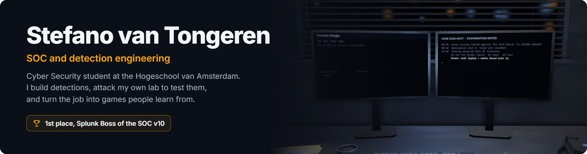
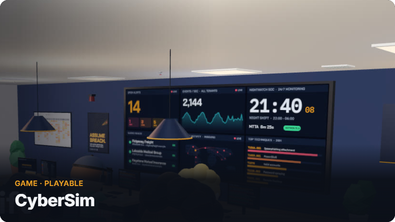
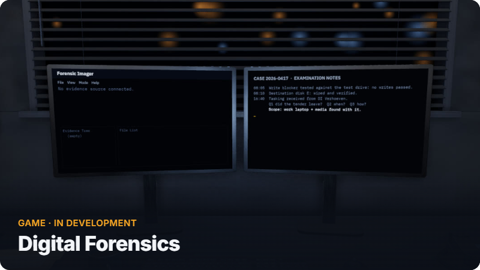
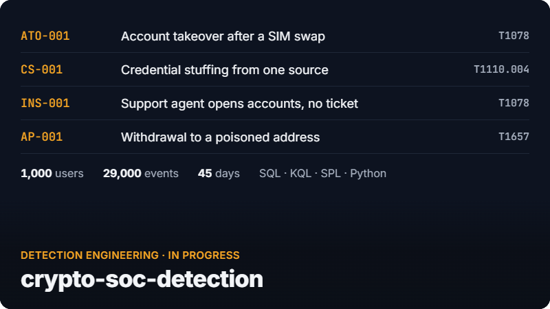
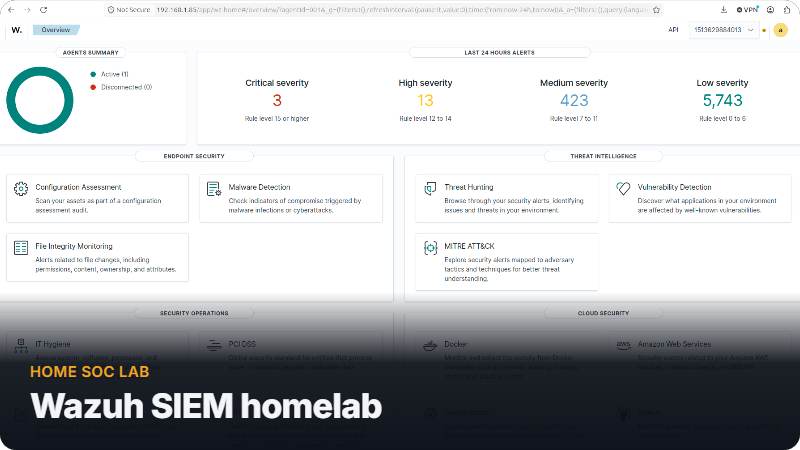
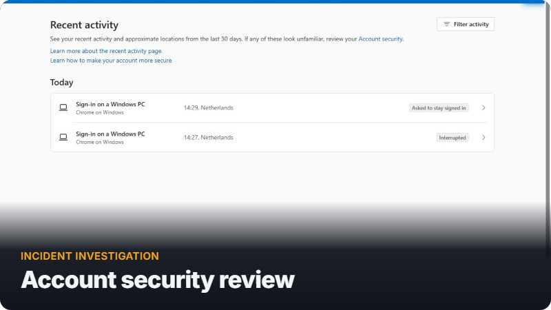
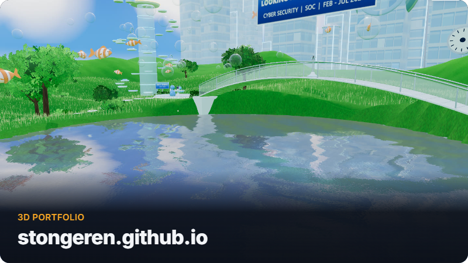

I'm a Cyber Security student at the Hogeschool van Amsterdam (Associate degree, 2025-2027), focused on **SOC operations and detection engineering**, with a special interest in security for crypto exchanges. With a team of three HvA students I won **1st place at Splunk Boss of the SOC (BOTS) v10** (Cisco Amsterdam, November 2026), which earned us an invite to the EMEA BOTS in March 2027.

**Looking for:** an internship (February to July 2027) or junior role in SOC, detection engineering or crypto security, in the Netherlands or remote.

## Featured work

<table>
<tr>
<td width="50%" valign="top">

<b><a href="https://github.com/STongeren/cybersim">CyberSim</a></b> 
A SOC career game in the browser: triage alerts, hunt in KQL and SPL, fight live intrusions and run the SOC. <a href="https://www.playcybersim.com">Play it free</a>.
</td>
<td width="50%" valign="top">

<b><a href="https://github.com/STongeren/digital-forensics-game">Digital Forensics</a></b> 
A first-person police forensics game: chain of custody, imaging, examination and a defence lawyer in court.
</td>
</tr>
<tr>
<td width="50%" valign="top">

<b><a href="https://github.com/STongeren/crypto-soc-detection">crypto-soc-detection</a></b> 
Detections for a crypto exchange, scored against labelled synthetic logs. One query language per week.
</td>
<td width="50%" valign="top">

<b><a href="https://github.com/STongeren/wazuh-siem-homelab">Wazuh SIEM homelab</a></b> 
Kali attacks a Windows endpoint; Wazuh and Sysmon catch Mimikatz, brute force and a Metasploit reverse shell.
</td>
</tr>
<tr>
<td width="50%" valign="top">

<b><a href="https://github.com/STongeren/account-security-review">Account security review</a></b> 
My own compromised mailbox investigated like a SOC case, plus a checklist and a leaked-password checker.
</td>
<td width="50%" valign="top">

<b><a href="https://stongeren.github.io/">Portfolio</a></b> 
My portfolio as a walkable 3D world, with a working desktop OS on the screen.
</td>
</tr>
</table>

Also: **[NullHawk](https://github.com/STongeren/nullhawk)**, my fork of an autonomous AI pentest system that refuses to attack a target until you prove you own it with a DNS record.

## Toolbox

- **SOC:** Wazuh, Microsoft Sentinel, Splunk, Sysmon, MITRE ATT&CK
- **Query and code:** KQL, SPL, SQL, Sigma, Python, Go, TypeScript
- **Offensive:** Kali Linux, Metasploit, OSINT, OT/ICS (Siemens S7-1200, Modbus)
- **Infra:** Linux, Docker, AWS, Git

[LinkedIn](https://www.linkedin.com/in/stongeren/) · [Website](https://stongeren.github.io/)
